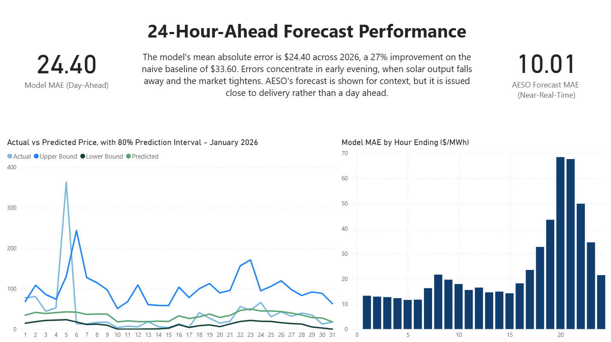
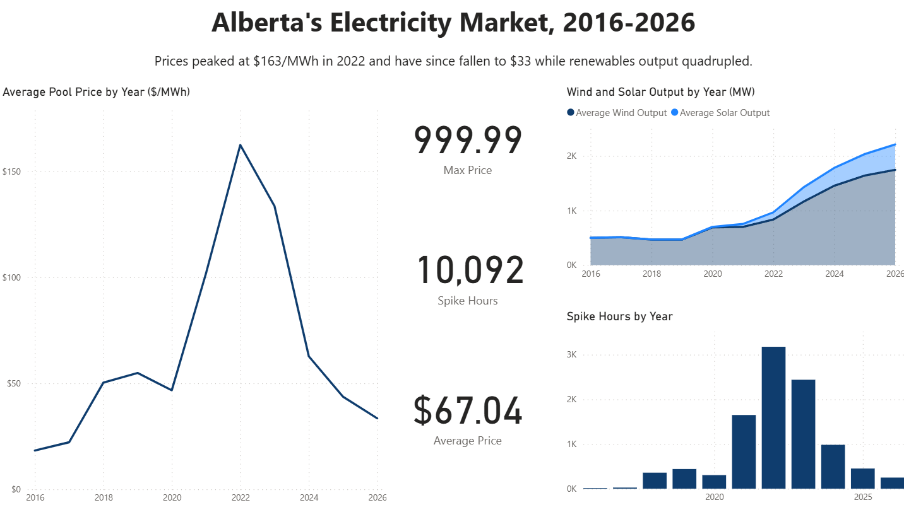
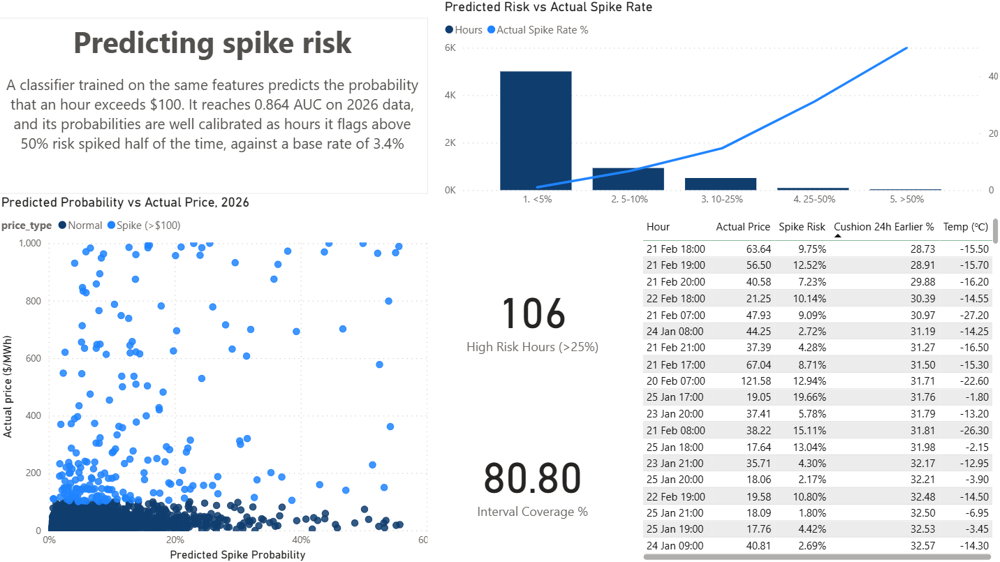

# Alberta Electricity Price Forecasting

Forecasting hourly Alberta pool prices 24 hours ahead, and estimating the risk of price spikes, using public data from the Alberta Electric System Operator (AESO) and Environment and Climate Change Canada (ECCC).

The pipeline is written in R, stores its data in DuckDB with most transformations in SQL, models with XGBoost, and feeds a three-page Power BI dashboard.



## Results

All results are on a held-out test period of **January 1 to September 30, 2026 (6,551 hours)**. Each forecast is issued at midnight for the next 24 hours, using only information available at that time.

| Model | MAE ($/MWh) | MAE, normal hours | MAE, spike hours |
|---|---|---|---|
| Naive: same hour yesterday | 33.6 | 24.1 | 303 |
| Linear regression | 42.3 | 33.7 | 287 |
| XGBoost, price, demand and renewables features | 26.8 | 15.9 | 338 |
| **XGBoost + supply cushion and weather** | **24.4** | **13.4** | 338 |
| Two-part model (spike classifier × price models) | 27.1 | 17.4 | 304 |
| AESO's own forecast (shorter horizon, context only) | 10.0 | 5.3 | 145 |

- The best model is **27% more accurate than the naive baseline**. Adding supply cushion and weather features cut MAE by **9%** compared with the same model without them.
- A **spike classifier** (probability that price exceeds $100/MWh) reaches an **AUC of 0.864**, up from 0.799 without the supply and weather features. Its probabilities are well calibrated: hours rated under 5% risk spiked 1% of the time, and hours rated over 50% spiked 50% of the time.
- **Prediction intervals:** the raw 80% interval from quantile regression covered only 66% of test hours. Rolling-window conformal calibration brought coverage to **80.8%**, and monthly coverage stayed between 76% and 87%.
- AESO's forecast is updated within the day, so it has much more recent information than a forecast made at midnight. It is shown for context, not as a like-for-like comparison.

## What drives prices

- **Supply cushion** is the strongest signal. Cushion here means spare controllable capacity as a percentage of net load. Hours with a cushion of 10–20% spiked 90% of the time, while hours above 100% almost never did.
- **Net load explains price better than demand.** Net load is demand minus wind and solar. At 11,000–12,000 MW, 46% of hours spiked when grouped by net load, against 22% when grouped by demand.
- **Temperature has a U-shaped effect.** Spike rates climb above 80% below −35 °C and above 30 °C.
- **Prices peak in the early evening.** Over the last three years, the average price at hour ending 20 was $101/MWh, against $26 at hour ending 4. Model errors are concentrated in the same hours.

## Dashboard

| Market history, 2016–2026 | 24-hour-ahead forecast performance | Spike risk |
|---|---|---|
|  |  |  |

To explore the report interactively, open [`aeso_dashboard.pbix`](dashboard/aeso_dashboard.pbix) in Power BI Desktop (free, Windows), which has the data built in.

## Pipeline

| Script | What it does |
|---|---|
| `01_pull_data.R` | Pulls hourly pool prices from the AESO Pool Price API, one CSV per month |
| `02_load_duckdb.R` | Combines the price files, runs data quality checks, loads them into DuckDB |
| `03_pull_load.R` | Pulls actual and forecast Alberta Internal Load (demand) from the AESO API |
| `04_join_data.R` | Joins demand to prices in SQL to build the hourly table |
| `05_generation.R` | Reads per-plant AESO generation files, totals output by fuel type, adds net load |
| `06_features.R` | Builds lagged price, renewables and calendar features with SQL window functions, and splits by time |
| `07_model.R` | Naive baselines, linear regression, XGBoost variants and a spike classifier |
| `08_supply_features.R` | Supply cushion from plant capacity, and hourly Calgary and Edmonton weather from ECCC |
| `09_model2.R` | Adds supply and weather features, quantile models and a two-part spike model |
| `10_intervals.R` | Conformalized quantile regression to calibrate the prediction intervals |
| `11_adaptive_intervals.R` | Rolling-window, adaptive and risk-conditional conformal intervals |
| `12_export_powerbi.R` | Exports fact and dimension tables as CSV and Parquet for Power BI |

**Data split:** training from January 2021 to June 2025, validation from July to December 2025, and testing from January to September 2026. The split is by time, never random, so every model is tested on hours that come after everything it was trained on. Training starts in 2021 because the grid before then, with coal plants and far less wind and solar, behaves differently from today's.

## Data sources

- **AESO API:** hourly pool price (Pool Price Report v1.1), and actual and forecast Alberta Internal Load (Actual Forecast Report v1). A free API key is needed.
- **AESO CSD Generation (Hourly) reports:** per-plant output and available capacity, downloaded manually from AESO's Generation Data folder. These are published monthly, a few days after each month ends.
- **ECCC hourly climate data:** temperature and wind speed at Calgary and Edmonton international airports.

## How to run

1. **Clone the repo** and open `aeso-price-forecast.Rproj` in RStudio.
2. **Install packages.** This project uses `renv`, so run `renv::restore()` to install the same package versions.
3. **Add your AESO API key.** Sign up at the [AESO API portal](https://developer-apim.aeso.ca/), subscribe to the Pool Price and Actual Forecast reports, then run `usethis::edit_r_environ()` and add `AESO_API_KEY=your_key_here`. Restart R.
4. **Download the generation data.** Download the CSD Generation (Hourly) zips from AESO and set their paths in `OUTER_ZIPS` at the top of `05_generation.R`.
5. **Run the scripts in order:**
   ```r
   scripts = sort(list.files(pattern = "^[0-9]{2}_.*\\.R$"))
   for (f in scripts) {
     message("Running ", f)
     source(f)}
   ```
   The API scripts skip months that are already downloaded, so re-running only fetches new data.
6. **Open the Power BI report** and refresh it. It reads the CSVs in `data/powerbi/`.

All data is rebuilt by the scripts, so the `data/` folder is not included in the repo.

## Limitations

- **Weather is treated as a perfect forecast.** The models use the observed temperature and wind speed for each hour, standing in for a weather forecast. Day-ahead temperature forecasts are accurate to a degree or two, so this is a reasonable stand-in, but results in live use would be somewhat worse.
- **Spike hours remain hard.** Every interval method covers fewer than 30% of spike hours, and point-forecast errors on spike hours are large. The spike classifier is the more useful tool for those hours.
- **There is one test period.** Results come from a single nine-month window. Evaluating month by month with retraining would show how stable they are.
- **Generation data lags.** The generation files are published monthly, so the most recent weeks can't be used until the next file is released. The scripts automatically end the test period at the last hour with generation data.

## Tools

R (httr2, dplyr, lubridate, readr, DBI, duckdb, xgboost), SQL (DuckDB), Power BI.

## Author

Emaad Hasan
